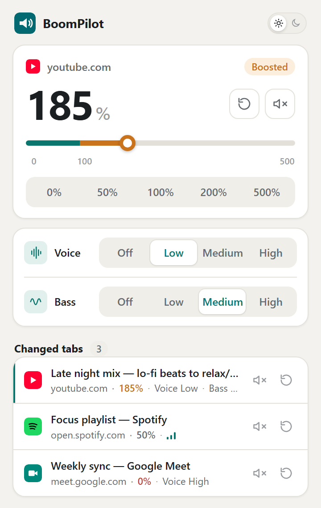
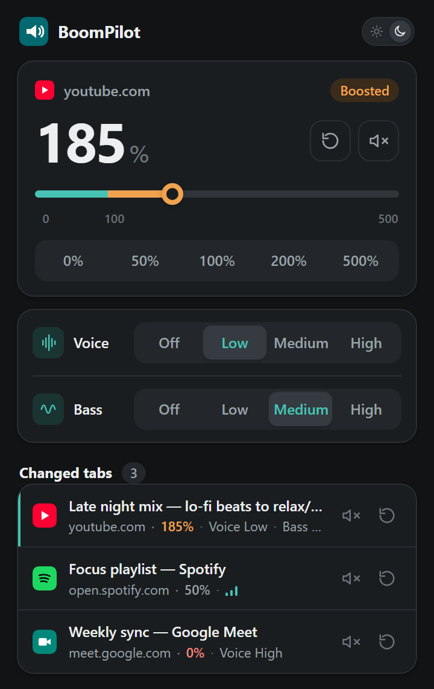

# BoomPilot 
**Per-tab volume control for Firefox with live updates, quick presets, and a clean changed-tabs dashboard.**

BoomPilot is a Firefox extension built for people who want tighter control over audio on a tab-by-tab basis. It lets you mute, lower, normalize, or boost a tab instantly, while also keeping track of every tab you changed in one compact control panel.

## Preview

  
  

<em>Design previews use sample tabs.</em>

## Why BoomPilot?

Firefox gives you basic tab mute controls, but sometimes that is not enough. BoomPilot adds a faster workflow for everyday audio control, especially when you are juggling YouTube, music tabs, streams, or background sites at the same time.

## Features

- **Live volume updates** while dragging the slider.
- **Per-tab control** from 0% to 500%.
- **Quick presets** for 0, 50, 100, 200, and 500.
- **Quick actions** for mute and reset.
- **Changed tabs list** with site favicon, volume badge, and one-click actions.
- **Toolbar badge** that shows changed volume and stays hidden at 100%.
- **Active tab sync** so popup controls reflect the current tab state.

## How it works

BoomPilot injects a content script into pages, including embedded frames such as video players on other sites, and adjusts their audio and video elements. Pages are left untouched until you change something.

- **Web Audio** is used when the page allows it. This gives boost up to 500%, the Voice and Bass effects, and a limiter that keeps boosted audio from clipping.
- **Direct volume control** is used for media loaded from another site without permission for audio processing, where Web Audio would play silence. Lowering and muting still work, but boost and effects can't go above 100%, and the popup shows **Limited**.

## Install

BoomPilot is distributed as a Mozilla-signed `.xpi` file for safer installation in Firefox.

1. Download the latest signed `.xpi` file from the releases page.
2. Open Firefox.
3. Open the downloaded `.xpi` file.
4. Firefox will display an installation prompt.
5. Click **Add** to install the extension.

## Usage

- Open the BoomPilot popup from the Firefox toolbar.
- Drag the slider for live adjustment.
- Use the preset buttons for fast jumps.
- Use the changed-tabs list to mute, reset, or jump to tabs you already modified.

## Notes

- Works best on sites using standard HTML5 audio or video.
- Boost and effects are unavailable on pages where the popup shows **Limited**.
- Some sites with DRM, heavily customized media pipelines, or other audio extensions may behave differently.
- Boosting very high values can introduce distortion depending on the source audio.
